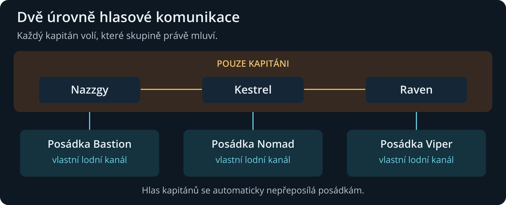
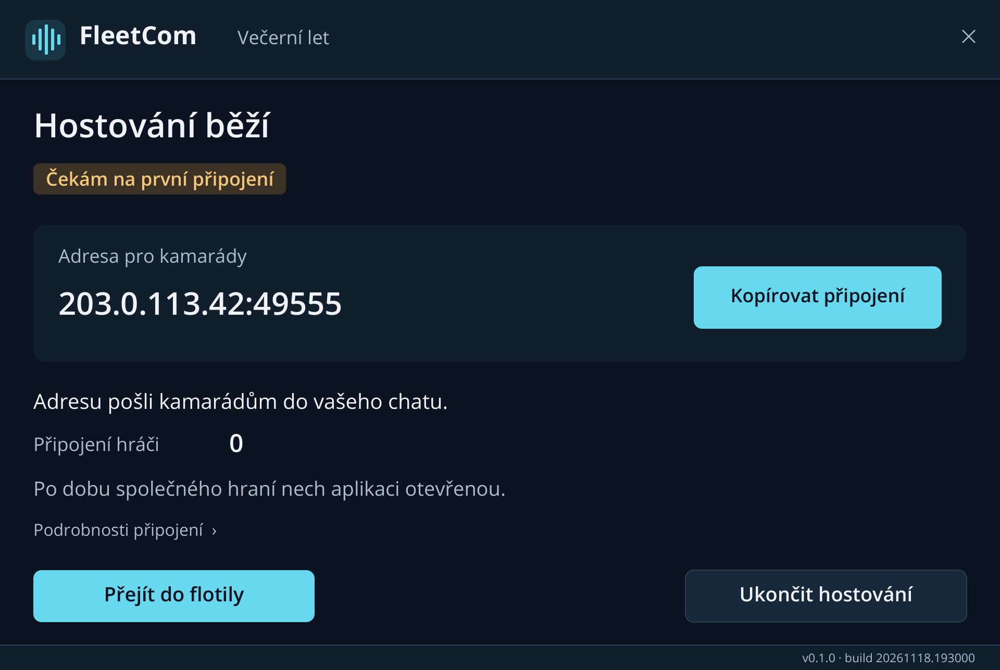
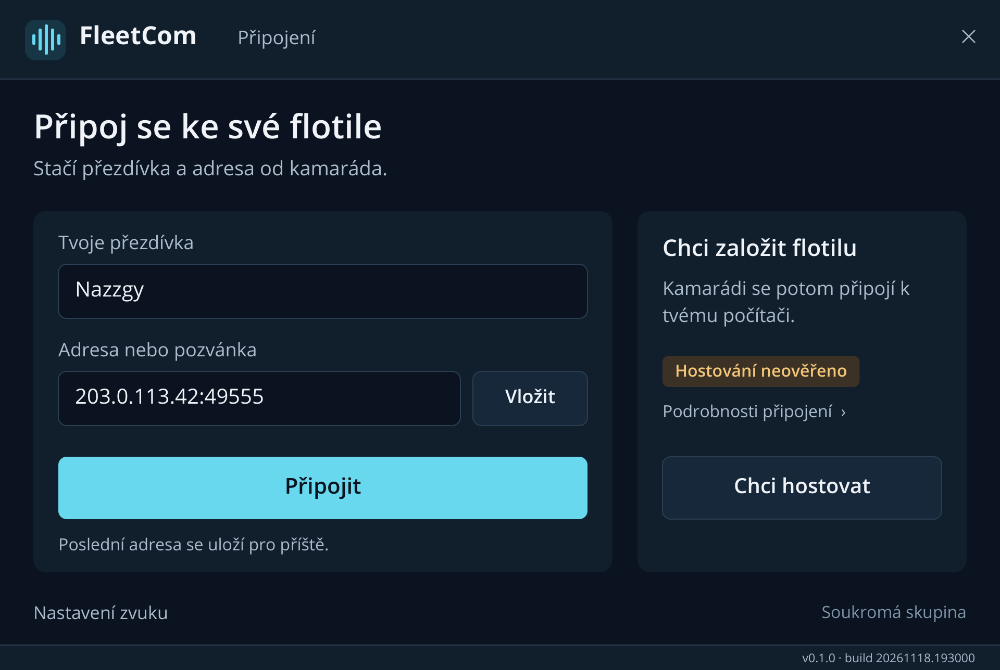
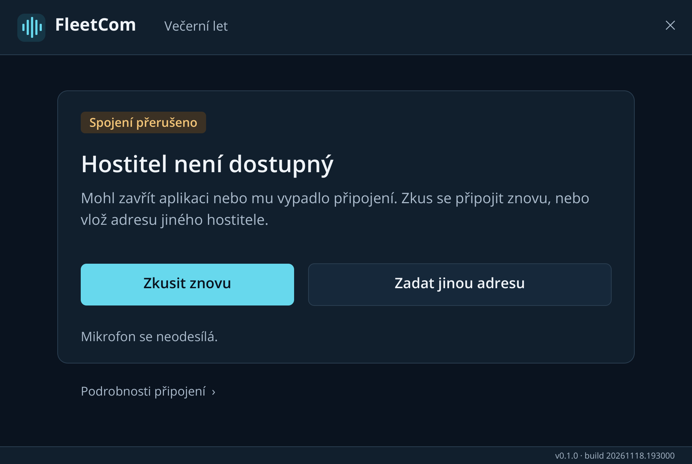
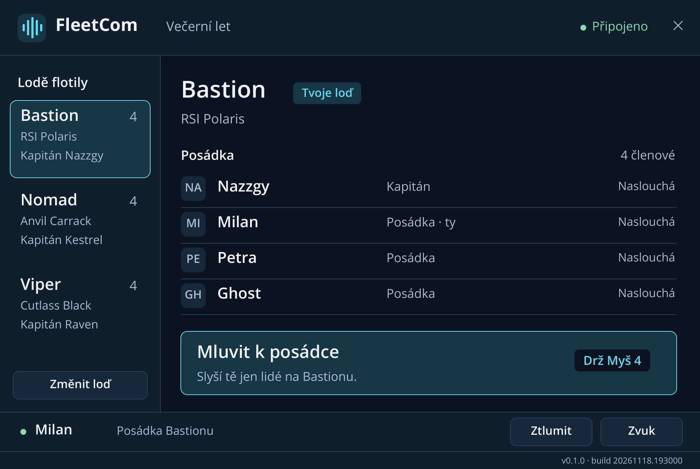
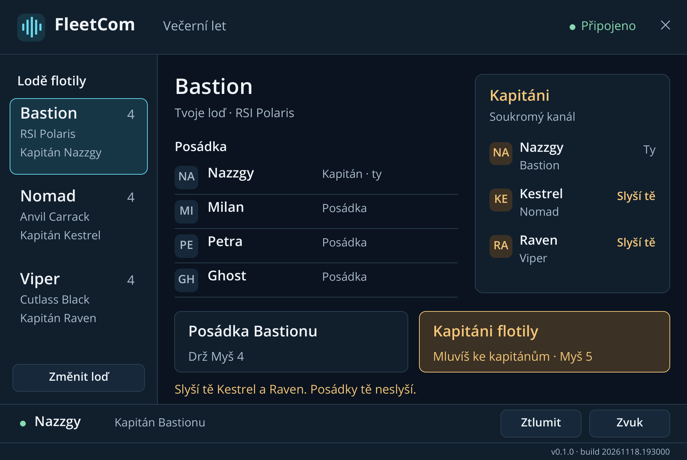
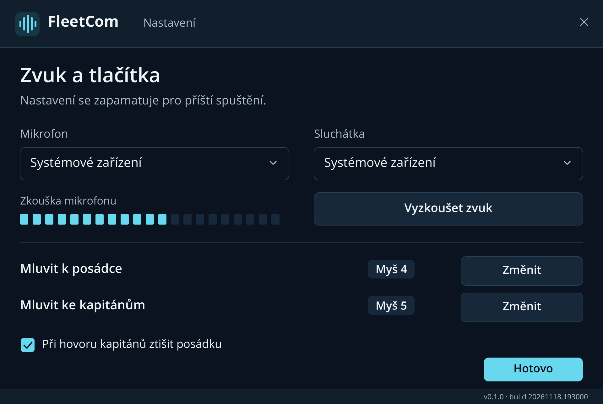
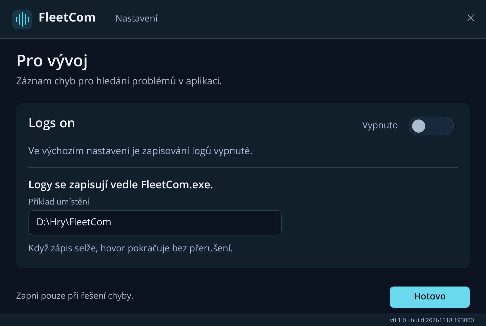

# StarComms kompletní zadání pro Codex

Verze zadání 2.0 · 18. listopadu 2026 · cílový produkt pro soukromou skupinu 10 až 12 hráčů Star Citizenu

## 1 Cíl a závazný rozsah

Codex má podle tohoto dokumentu implementovat dokončenou hlasovou aplikaci pro Windows. Výstup pro hráče je **jeden samostatný soubor `StarComms.exe`**. Uživatel jej sám zabalí a pošle kamarádům. Aplikace se spouští bez instalátoru, bez instalace .NET a bez dalších souborů připravovaných uživatelem. Stejný EXE slouží hostiteli i ostatním hráčům.

Jeden hráč zapne hostování přímo v aplikaci. Hostovací část běží pouze po dobu hraní uvnitř stejného programu. Ostatní vloží adresu nebo pozvánku, hostitel je přijme a každý vybere svou loď. Posádka slyší vlastní loď; kapitáni mají navíc společný velitelský kanál, který posádky neslyší.

Dokončení znamená skutečné snímání a přehrávání zvuku, přenos přes síť, oddělení oprávnění, ovládání během hry, zvládnuté výpadky a sestavený EXE. Obrázky, lokální simulace či obrazovka s nefunkčními tlačítky samy zadání nesplňují.

### 1.1 Pevná produktová rozhodnutí

- Počet přijatých hráčů nemá pevný limit. Nejvýše 12 lodí, jeden kapitán na loď a jedna loď na hráče.
- Český jazyk rozhraní. Kód, identifikátory a názvy testů mohou být anglicky.
- Žádný účet, veřejný seznam flotil, vlastní cloud, povinný STUN/TURN, služba pro zjišťování veřejné IP, telemetrie ani předplatné.
- Přímé spojení na ručně předanou adresu. Automatické nastavení routeru je pokus, nikoli záruka dosažitelnosti.
- Hostitel je důvěryhodný člen skupiny, provozuje směrování a spravuje flotilu. Šifrování chrání přenos mezi klientem a hostitelem; neslibuje utajení před vlastníkem hostitelského procesu.
- Hlas se odesílá při držení tlačítka. Posádka má jeden cíl, kapitán dva. Hovor do obou cílů současně není podporován.
- Žádná hlasová čekárna, nahrávání, textový chat, přenos souborů, automatické povýšení kapitána ani předání hostování za běhu.
- Žádný instalátor, MSI, MSIX, updater, Windows služba, autostart ani samostatný serverový EXE.
- Nastavení se může automaticky uložit do uživatelského profilu. Běžná automatická extrakční cache přibaleného runtime je přípustná; uživatel nic dalšího nepřipravuje.
- Logování je ve výchozím stavu vypnuté. Přepínač `Logs on` je zapne a logy vznikají přímo vedle `StarComms.exe`, nikoli v uživatelském profilu.
- Na všech obrazovkách je v pravém dolním rohu trvale viditelné číslo verze i sestavení. Rozdílné sestavení hostitele se při připojení srozumitelně oznámí.

### 1.2 Jak číst zadání

Číselné hodnoty, výchozí chování a pravidla v tomto dokumentu jsou implementační rozhodnutí. Codex je nemá nahrazovat obecnými návrhy. Drobné technické detaily může zvolit sám a zapsat do `docs/DECISIONS.md`. Text specifikace má přednost před ilustracemi, zejména u nově doplněné pozvánky s otiskem certifikátu. Ilustrační adresa `203.0.113.42` není běžící server.



## 2 Vybraný technický základ

| Oblast | Závazná volba | Důvod nebo hranice |
|---|---|---|
| Platforma | Windows x64, primárně Windows 11; kompatibilita Windows 10 22H2 | Desktopové ovládání během hry, společný jeden EXE |
| Jazyk a UI | C#, .NET 10, WPF, MVVM | Nativní okno a přímý přístup k Windows |
| Zvuk | NAudio 3.3.0, WASAPI shared mode | Skutečný mikrofon a zvuk současně se hrou [S2] |
| Kodek | Concentus 2.2.2, spravovaný Opus | Bez externího kodekového DLL; Concentus neřeší síťový přenos [S3] |
| Síť pro řízení | TCP a `SslStream`, TLS 1.2 nebo 1.3 podle OS | Délkově omezené JSON zprávy [S5] |
| Síť pro hlas | UDP, `Socket`, platformní `AesGcm` | Žádné opakování ztracených hlasových paketů [S6] |
| Router | Mono.Nat 3.0.4 | UPnP a NAT-PMP; PCP se v této verzi neimplementuje [S4] |
| Tlačítka během hry | Windows Raw Input | Stisk i uvolnění na pozadí přes `RIDEV_INPUTSINK` [S7] |
| Distribuce | Self-contained single-file publish pro `win-x64` | Jeden doručovaný EXE včetně runtime [S8] |
| Testy | xUnit a vlastní headless simulátor nad stejným jádrem | Ověření pravidel, skutečných socketů i dvanácti klientů |

Použít stabilní opravený SDK patch řady .NET 10 a zapsat přesnou verzi do `global.json`. Verze balíčků řídit v `Directory.Packages.props`; po prvním úspěšném restore uložit lock soubory. Nepoužívat plovoucí verze v dokončeném projektu. Verzi testovacích balíčků Codex ověří při inicializaci a připne. Uvedené verze hlavních knihoven jsou konkrétní výchozí volby; změnu vyžaduje doložená nekompatibilita nebo oprava a záznam rozhodnutí.

Nepřidávat `Concentus.Native`, FFmpeg, webový runtime, databázový server ani druhou alternativní aplikaci. Dokumentace NAudio 3 má přednost před starými příklady pro NAudio 2.

### 2.1 Struktura řešení

| Projekt nebo cesta | Odpovědnost |
|---|---|
| `src/StarComms.Core` | Doménový model, oprávnění, změny flotily, PTT automat. Bez WPF a Windows API. |
| `src/StarComms.Engine` | TLS/UDP, serializace, host a klient, Opus, jitter buffer a síťová diagnostika. Testovatelné bez mikrofonu. |
| `src/StarComms.App` | WPF, Windows audio, Raw Input, nastavení, firewall a integrace Mono.Nat. Výsledné jméno assembly `StarComms`. |
| `tests/StarComms.Tests` | Doménové, protokolové a integrační testy. Virtualizovaný čas přes `TimeProvider`, žádná dlouhá skutečná čekání. |
| `tools/StarComms.Sim` | Headless host a syntetičtí klienti používající produkční engine a skutečné sockety. |
| `scripts` | Reprodukovatelný build, test a single-file publish. |
| `docs` | Rozhodnutí, návod, stav implementace a výsledky testů. |

Hostovací engine a vlastní klient hostitele jsou ve stejném procesu. Lokální klient používá stejnou autorizační a směrovací funkci jako síťoví klienti. Správcovské příkazy smí vyvolat pouze lokální reference hostitelského UI. Neexistuje vzdálená administrátorská role přidělitelná síťovým polem.

Všechny změny flotily zpracuje jeden serializovaný hostitelský dispatcher. Audio smyčky používají aktuální neměnný snapshot a před skutečným zařazením do odchozí fronty znovu ověří platnost oprávnění. Síťová ani zvuková smyčka nesmí běžet na WPF UI vlákně. Fronty musí mít explicitní limit; zrušení hostování ukončí jejich činnost přes společný cancellation token.

## 3 Doménový model a omezení

| Model | Povinná pole a pravidla |
|---|---|
| `FleetSession` | `sessionId: Guid`, `stateVersion: ulong`, název flotily, mapy členů a lodí. Nové hostování vždy vytváří nové `sessionId`. |
| `Member` | `memberId: uint`, přezdívka, `shipId: uint?`, `isCaptain: bool`, `isHost: bool`, `status: Online/Reconnecting`, `membershipEpoch: uint`. |
| `Ship` | `shipId: uint`, název, nepovinný model lodi, `captainMemberId: uint?`. |
| `ClientConnection` | Autentizované `memberId`, náhodné `connectionId: ulong`, řídicí spojení, UDP klíče, sekvence, ověřený UDP endpoint, stav hlasu. |
| `ResumeCredential` | Náhodný 256bitový token pro jednoho člena a aktuální relaci. Server uchovává jeho hash, klient token jen v paměti. |
| `AddressCandidate` | Adresa, rodina IPv4/IPv6, zdroj Interface/Router/Manual, rozsah InternetCandidate/LanOnly/Unusable, stav TCP a UDP, ověření jednotlivými spoluhráči. |

`memberId` a `shipId` přiděluje host, jsou v relaci nenulové a nerecyklují se. Nula na drátu znamená žádnou loď nebo nepoužité pole. ID není důkaz identity. Identitu určuje přijaté řídicí spojení a jeho přidělený hlasový klíč.

- Přezdívka: 2 až 24 Unicode textových prvků po oříznutí mezer a normalizaci NFC. Bez řídicích znaků. Duplicitní jméno porovnané `OrdinalIgnoreCase` se odmítne; nepřebírá cizí identitu.
- Název lodi: 1 až 32 textových prvků; model lodi 0 až 48; flotila 1 až 40. Zachovat českou diakritiku.
- Nejvýše 8 čekajících žádostí a 24 současně rozjednaných řídicích spojení. Po přijetí se místo pro další žádost uvolní.
- Odpojený člen se rezervuje nejvýše 120 sekund. Do té doby může obnovit členství tokenem, i když prvních 15 sekund automatických pokusů již skončilo.
- Dobrovolný odchod, vyřazení hostitelem, uplynutí rezervace a konec relace token zneplatní. Obnovení nikdy nevychází jen z přezdívky.
- Platný token při stále aktivním původním spojení vrátí `ALREADY_CONNECTED`. Nepřepisuje živého hráče. Po detekci skutečného výpadku lze obnovit jedno spojení.
- `membershipEpoch` se zvýší při změně lodi, kapitána, odpojení i obnovení. Zastaralý hlas se zahodí. Při hypotetickém přetečení se spojení bezpečně obnoví s novou generací, nikdy neobtočí na starou hodnotu.
- `stateVersion` se zvýší při každé potvrzené změně zveřejněného stavu. Snapshot je úplný; při zjištěné nesrovnalosti klient vyžádá nový.

## 4 Spuštění a hostování

### 4.1 Spuštění programu

Program načte nastavení, zobrazí přezdívku a poslední adresu a nezávisle prohlédne místní síťová rozhraní. Pouhé spuštění neotvírá poslouchající port ani nevytváří routerové mapování. Připojení k jinému hostiteli nečeká na dokončení diagnostiky vlastního hostování.

### 4.2 Algoritmus po volbě Hostovat

1. Vytvořit novou relaci a načíst místní hostitelský certifikát; při prvním hostování jej vygenerovat.
2. Zkusit TCP i UDP na portu 49555. Je-li port obsazen, zkusit postupně 49556 až 49565. Vybraný port musí být volný pro oba protokoly. Neúspěšný pokus zavře i částečně otevřené sockety.
3. Pro každou podporovanou rodinu adres otevřít TCP a UDP. Použít samostatné IPv4 a IPv6 sockety s jednoznačným nastavením `IPv6Only`; nepovolit nechtěný dvojí bind. Nepodporované IPv6 nezruší funkční IPv4 a obráceně.
4. Místním handshake potvrdit běh enginu. Místní test ani NAT hairpin se nesmí označit za internetový test.
5. Zkontrolovat dostupné informace o Windows Firewall. Případné povolení nabídnout akcí `Povolit hostování ve Windows`.
6. Zahájit discovery Mono.Nat, s rozpočtem 8 sekund a celkovým automatickým rozpočtem přípravy 10 sekund. Vyzkoušet dostupné UPnP, následně NAT-PMP. Operace na témže routeru serializovat.
7. Zjistit vnější adresu routeru a pokusit se vytvořit TCP i UDP mapování. Pro jednoduché připojení musí mít obě mapování stejný skutečný vnější port. Pokud router přidělí rozdílné porty, vyzkoušet nejvýše další dva společné kandidáty; při neúspěchu označit automatickou přípravu jako neúplnou.
8. Sestavit kandidátní adresy a nabídnout kopírování připojení. Neúspěch routeru sám nezastaví místně běžící hostování.
9. Teprve skutečný přijatý vzdálený klient s ověřenou obousměrnou UDP cestou potvrdí spojení s tímto konkrétním hráčem.

Požadovat konečnou dobu mapování 7200 sekund a obnovovat při polovině skutečně přidělené doby. Pokud router umožňuje pouze permanentní mapování, automatický pokus této verze neprovádět a ukázat neověřený stav. Nepřepisovat existující cizí mapování. Evidovat pouze vlastní úspěšně vytvořená mapování a při ukončení je odstranit s limitem 2 sekund na zařízení. Selhání úklidu nesmí blokovat zavření; konečný lease omezuje pozůstatek po pádu.

### 4.3 Výběr adresy

Z `NetworkInterface.GetAllNetworkInterfaces()` brát aktivní rozhraní a aktuální platné unicast adresy. Zvláštní rozsahy klasifikovat pomocí lokální tabulky založené na IANA [S9]. Tabulku aplikace za běhu nestahuje.

Privátní IPv4, `100.64.0.0/10`, loopback, link-local, dokumentační, multicast a rezervované adresy nesmí dostat označení veřejné internetové adresy. Stejně tak IPv6 ULA, link-local, loopback, multicast a dokumentační rozsahy. Adresy pro LAN zůstávají použitelné pro místní síť a testování.

Preferovat veřejný IPv4 kandidát připravený mapováním nebo přímo na rozhraní, jinak vhodný globální IPv6 kandidát. IPv6 zapisovat s portem jako `[adresa]:port`. K IPv6 jedinému kandidátu uvést: `Spoluhráč musí mít funkční připojení přes IPv6.` Nepředpokládat, že se k němu připojí IPv4 klient.

V podrobnostech dovolit ruční vnější IP a port pro uživatele s již nastaveným routerem. Jde o neověřeného kandidáta. Nepředávat `0.0.0.0` ani `::` jako cílovou adresu. Bez vhodné adresy ponechat místní host aktivní, nabídnout adresu pro LAN a připojení k jinému hostiteli.

### 4.4 Stavy hostování

| Interní stav | Viditelný text a význam |
|---|---|
| `Idle` | Hostování není spuštěné. |
| `Preparing` | Připravuji hostování. Lze zrušit; běžné připojení není trvale blokováno. |
| `ListeningUnverified` | Připraveno k hostování. Čekám na první připojení. Existuje kandidát, ne důkaz internetového průchodu. |
| `ListeningAddressUnknown` | Adresu pro internet se nepodařilo zjistit. Nelze automaticky ověřit. |
| `ListeningVerified` | Spojení ověřeno s konkrétními hráči. Každý další hráč ověřuje vlastní cestu. |
| `PreparationFailed` | Hostování se nepodařilo spustit. Nutné místní TCP/UDP sockety nelze připravit. |
| `Stopping` | Ukončuji hostování. Zavření spojení, front a vlastních mapování. |

Změna síťového rozhraní vyvolá nové zjištění kandidátů a zneplatní staré označení dostupnosti. Připojené klienty zachovat, pokud jejich cesty dál fungují; při skutečné ztrátě použít pravidla obnovy.

### 4.5 Windows Firewall

Celý program běží jako běžný uživatel, manifest `asInvoker`. Standardní systémový dotaz na síťové oprávnění je přípustný. Volitelné tlačítko pro přípravu firewallu může znovu spustit **tentýž EXE** v krátkém režimu `--configure-firewall` s UAC. Tento režim pouze přidá nebo aktualizuje vlastní dvě pravidla a skončí; nevytváří službu.

Pravidla omezit na cestu aktuálního EXE, konkrétní TCP/UDP port a zvolený aktivní profil. Cestu určit z `Environment.ProcessPath`, nikoli ze síťového vstupu. Port validovat na rozsah 1 až 65535. Použít Windows API, nespouštět sestavený shellový příkaz z libovolného textu. Nevypínat firewall ani neměnit globální politiku. Odmítnutí UAC ponechá klientský režim použitelný. Pravidla mohou zůstat pro příští hraní; bez spuštěného listeneru nic nehostují. Routerová mapování se naopak uklízejí při ukončení.



Ilustrace ukazuje jednoduchou adresu. V implementaci tlačítko `Kopírovat připojení` kopíruje úplnou pozvánku podle další kapitoly; čistá IP a port zůstávají viditelné a samostatně kopírovatelné v podrobnostech.

## 5 Připojení a ověření hostitele

### 5.1 Jeden vstup pro adresu i pozvánku

Pole má popisek `Adresa nebo pozvánka od hostitele`. Přijme IPv4, `IPv4:port`, holou IPv6 bez portu, `[IPv6]:port` a pozvánku StarComms. Chybějící port znamená 49555. Oříznout okolní mezery, nic nespouštět a neotvírat vloženou hodnotu v prohlížeči. Nepodporovat DNS jména v první verzi. Nejednoznačný nebo neplatný formát ukáže chybu přímo u pole. Maximum vstupu 1024 znaků.

Závazný tvar pozvánky:

```text
starcomms://join?v=1&host=203.0.113.42&port=49555&fp=<64-hex-znaku>
```

`host` je IP literal v query zakódovaný standardním URI escaping; u IPv6 bez hranatých závorek uvnitř query. `fp` je SHA-256 celého DER certifikátu hostitele, 64 hex znaků. Přijmout hex bez rozlišení velikosti, normalizovat na malá písmena. Parametry `v`, `host`, `port`, `fp` jsou povinné právě jednou; duplicity a nepodporovanou verzi odmítnout. Pozvánka neobsahuje soukromý klíč ani obnovovací token a sama neobchází přijetí hostitelem. Neregistrovat systémový URL handler; stačí vložení do aplikace.

### 5.2 Certifikát

Při prvním hostování vygenerovat přes platformní API ECDSA P-256 klíč a self-signed certifikát s účelem Server Authentication, platností jeden rok a tolerancí začátku platnosti 5 minut do minulosti. Certifikát a klíč zachovat pro další spuštění, chránit DPAPI pro aktuálního uživatele. Nevkládat certifikát do důvěryhodných kořenů Windows.

Pokud je otisk v pozvánce nebo v dříve potvrzeném záznamu hostitele, TLS přijme pouze přesně shodný certifikát s platnou dobou a očekávaným účelem. Vlastní validace může pro tento přesný pin přijmout self-signed řetězec a chybějící DNS jméno. Obecný callback vracející vždy `true` je zakázaný.

Při první ručně vložené IP bez uloženého pinu provést zjišťovací TLS handshake, zachytit certifikát a nechat jej bez schváleného pinu selhat. Před odesláním přezdívky nebo tokenu ukázat `První připojení k tomuto hostiteli` s akcemi `Důvěřovat a připojit` a `Zrušit`; plný otisk je dostupný v podrobnostech. Po potvrzení zopakovat handshake s konkrétním pinem. To je výslovné první přijetí identity uživatelem, nikoli automatický důkaz, komu IP patří. Běžná kopírovaná pozvánka tento krok nepotřebuje.

Změněný známý otisk nesmí být potichu přijat. Ukázat `Identita hostitele se změnila` a požadovat nové výslovné potvrzení nebo novou pozvánku. Po uplynutí platnosti host obnoví certifikát a aplikace jej upozorní na novou pozvánku. Pin ani token se nesmí získávat přes externí službu.

### 5.3 Přijetí a inicializace hlasu

1. Navázat TCP a dokončit ověřené TLS; společný limit 10 sekund.
2. Vyměnit protokolové hello, limit 5 sekund. Neslučitelnou verzi odmítnout s českým vysvětlením.
3. Nový klient požádá o přijetí přezdívkou. Host vidí `Přijmout` a `Odmítnout`; čekání má limit 60 sekund a klient je může zrušit.
4. Před přijetím klient nemá hlasové klíče, plný roster ani žádný hlas. Po přijetí dostane identitu, obnovovací token, čerstvé UDP klíče a úplný snapshot.
5. Ze svého UDP socketu provede autentizovaný tříkrokový probe. Teprve po něm je hlas označen jako připravený. TCP samo nestačí.
6. Přijatý hráč bez lodi zvolí loď. Žádný společný hlas před výběrem neexistuje. Chybějící PTT vazbu nastaví jedním stiskem.

Pokud řídicí spojení funguje, ale hlasový probe do 5 sekund neprojde, zobrazit `Hlasové spojení se nepodařilo navázat` a tlačítko `Zkusit hlas znovu`. Člen může zůstat ve flotile a vidět její stav, ale PTT je vypnuté a zelené `Připojeno` se nenahradí falešným tvrzením funkčního hlasu. TCP hlasový fallback se v této verzi neimplementuje.



## 6 Správa flotily a pravidla změn

Hostitel může vytvářet, přejmenovat a rušit lodě, přiřadit kapitána, přesunout člena, přijmout nebo odmítnout žádost a vyřadit člena. Nová relace může načíst uložené názvy lodí, nikdy staré role a obsazení. Prázdný stav hostiteli nabídne `Vytvořit první loď`.

Kapitán může předat velení připojenému členovi své vlastní lodi. Posádka může dobrovolně přestoupit. Pouhé prohlížení jiné lodi nic nemění. Hostitel nemá automatický velitelský poslech, pokud není sám kapitánem.

### 6.1 Přestup a předání velení

Příkaz obsahuje `expectedMembershipEpoch` a identifikátor cíle. Host v jedné transakci ověří právo, ukončí staré vysílání, změní členství nebo kapitána, zvýší epochy dotčených členů a publikuje nový snapshot. Klient do potvrzení nepředstírá novou loď. Příchozí budoucí audio epochy zahodí do přijetí odpovídajícího snapshotu.

Přestup kapitána jej zbaví velení původní lodi; nová loď jej přijme jako posádku. Při předání velení dostane loď právě jednoho nového kapitána. Starý kapitán ztratí velitelský příjem i vysílání. Nový kapitán bez druhé PTT vazby poslouchá, ale tlačítko pro velitelské vysílání nabídne nastavení.

Zrušení neprázdné lodi vyžaduje jednu jasnou otázku `Zrušit loď a přesunout její členy do výběru lodí?`. Potvrzení odstraní loď a členy nechá bez hlasového kanálu. Hostitel nemůže vyřadit sám sebe; pro něj je akcí ukončení hostování.

Po výpadku kapitána nevzniká náhrada automaticky. Přiřazení může zůstat rezervované do návratu nebo zásahu hostitele. Pokud hostitel jmenuje náhradu, navrácený původní kapitán je posádka. Obnova vždy přebírá aktuální hostitelský stav.

Již doručený zvuk nelze zpětně odvolat. Přesná garance je: po potvrzení změny host nezařadí nové audio pro neoprávněného příjemce a klient po přijetí nového stavu vyprázdní neplatné přehrávací fronty. Test nesmí vyžadovat fyzikálně okamžité odvolání paketu, který již před změnou odešel.

## 7 Řídicí protokol TCP

Veškeré řízení probíhá uvnitř ověřeného TLS spojení. TLS verze nižší než 1.2 se nepřijímají. Použít systémové bezpečné šifrové sady; nevymýšlet vlastní TLS algoritmy.

### 7.1 Framing a envelope

Každá zpráva je 4bajtová délka `UInt32` v big-endian pořadí, následovaná právě tímto počtem UTF-8 bajtů JSON. Délka musí být 1 až 65536; maximální JSON hloubka 16. Přijímač zvládne částečná čtení i více zpráv v jednom čtení. Síťová délka nesmí řídit neomezenou alokaci. Každé spojení má jedinou serializovanou zapisovací frontu s limitem 128 zpráv; pomalé spojení, které limit překročí, se odpojí místo neomezeného hromadění.

```json
{
  "v": 1,
  "type": "JoinShip",
  "id": "9ba18eb7-4151-4f37-99ed-6b8c27bec962",
  "replyTo": null,
  "body": { "shipId": 2, "expectedMembershipEpoch": 4 }
}
```

`v` je číslo protokolu 1. `type` je pevný whitelist. `id` je GUID každého požadavku, `replyTo` odkazuje na příslušný požadavek u odpovědi; push zprávy mají obě hodnoty null. Číselné doménové hodnoty jsou JSON integers, GUID canonical řetězce, binární klíče a tokeny Base64. Žádná reflexivní deserializace libovolných .NET typů. Neznámá doplňková JSON pole lze ignorovat, chybějící povinná nebo neznámý typ zprávy se odmítnou.

Mutace jsou idempotentní podle `id`. Host uchová posledních 64 výsledků na spojení po 60 sekund; stejný požadavek nezpůsobí druhý přestup. Běžný požadavek čeká nejvýše 5 sekund. Po timeoutu klient načte snapshot a nezopakuje automaticky mutaci s novým ID.

### 7.2 Povinné zprávy

| Typ a směr | Tělo a význam |
|---|---|
| `ClientHello` C do H | `protocolVersion`, `appVersion`, `nickname`, `resumeSessionId?`, `resumeToken?`. Žádná klientem určovaná role. |
| `ServerHello` H do C | `protocolVersion`, `appVersion`, `sessionId`, `fleetName`, `capacity=0 (bez pevného limitu)`. Před přijetím bez seznamu členů. |
| `AdmissionPending` H do C | `expiresInSeconds=60`. UI čekání. |
| `Accepted` H do C | `memberId`, `connectionId`, `resumeToken`, `udpKeyC2H`, `udpKeyH2C`, `noncePrefixC2H`, `noncePrefixH2C`, `snapshot`. Každé TLS obnovení vydá nové UDP údaje. |
| `Rejected` H do C | `code`, poté ukončení. Například FULL, DENIED, NAME_IN_USE, VERSION_MISMATCH, RESUME_INVALID. |
| `VoiceReady` H do C | `connectionId`, potvrzení proběhlého UDP probe. |
| `SnapshotRequest` C do H | Prázdné tělo. |
| `FleetSnapshot` H do C | `sessionId`, `stateVersion`, pole lodí a přijatých členů podle kapitoly 3. Bez tokenů, klíčů a IP ostatních. |
| `JoinShip` C do H | `shipId`, `expectedMembershipEpoch`. Přestup vlastní identity. |
| `TransferCaptain` C do H | `shipId`, `newCaptainMemberId`, `expectedMembershipEpoch`. Povoleno jen aktuálnímu kapitánovi této lodi. |
| `Result` H do C | `ok`, `code?`, `stateVersion`, `replyTo`. Úspěšná mutace také publikuje snapshot. |
| `VoiceEnd` oba směry | `senderId`, `senderEpoch`, `recipientEpoch`, `channel`, `shipId`, `talkBurstId`, `lastFrameIndex`. Klient posílá recipientEpoch 0, host ji doplní pro příjemce. Oprávnění a cíl se ověřují stejně jako u Voice. |
| `Ping` a `Pong` oba směry | `nonce: ulong`; kontrola řídicího spojení každé 2 sekundy. |
| `Leave` C do H | Prázdné tělo; zneplatnění tokenu, odchod. |
| `SessionEnded` H do C | `reason=HOST_LEFT`; řízené ukončení relace. |
| `Removed` H do C | `reason=REMOVED_BY_HOST`; odpojení a zneplatnění obnovy. |

Správcovské příkazy `CreateShip`, `RenameShip`, `DeleteShip`, `AssignCaptain`, `MoveMember`, `Admit`, `Reject` a `RemoveMember` jsou lokální volání dispatcheru, ne vzdálené síťové zprávy. Každý výsledek mění stejný stav a stejné epochy jako odpovídající uživatelská akce. Vzdálený pokus o tyto typy se odmítne.

Klient na novém připojení přijímá nové `connectionId`; staré UDP klíče a všechny fronty zničí. Obnovovací token může zůstat stejný po dobu jedné relace, aby ztráta odpovědi při obnově nezpůsobila nevratné odhlášení. Nesmí se znovu použít staré transportní klíče.

`appVersion` v obou hello zprávách je úplná informační verze včetně buildId z kapitoly 12.2, nikoli napevno napsaný text. Rozdílný protocolVersion se odmítne jako VERSION_MISMATCH. Shodný protocolVersion s odlišným appVersion připojení nezablokuje, ale ukáže neblokující upozornění `Máš jiné sestavení než hostitel` s oběma hodnotami. Oba účastníci mohou verze snadno porovnat v rohu. Tato výstraha se nesmí vydávat za nekompatibilitu protokolu.

Po 6 sekundách bez platného Pong nebo po uzavření TLS se spojení považuje za ztracené. Hlasové pakety samy tento timeout nenahrazují. Limit požadavků na přijatého klienta je 20 zpráv za sekundu s krátkým burstem 40; Ping/Pong mají oddělený malý limit. Při překročení se požadavek odmítne a soustavně vadné spojení odpojí.

## 8 Hlasový protokol UDP

Toto je vlastní malý aplikační protokol nad platformním AES-GCM. Nepopisovat jej jako implementaci WebRTC, DTLS nebo standardního RTP. Kodér Opus, TLS a AES-GCM se používají z ověřených knihoven; jejich algoritmy se nepíšou znovu.

### 8.1 Klíče a obálka

Po přijetí host vygeneruje pro každé spojení dva nezávislé náhodné 32bajtové klíče a dva náhodné 4bajtové nonce prefixy pomocí `RandomNumberGenerator`. Jeden pár je pro klient do hosta, druhý pro host do klienta. Žádný společný klíč flotily. Údaje se předají jen přes ověřené TLS.

Datagram má 24bajtovou viditelnou hlavičku, šifrovaný payload a 16bajtový GCM tag. Všechna vícebajtová čísla na UDP drátu jsou big-endian. Celá viditelná hlavička je AAD.

| Offset | Délka | Pole |
|---|---|---|
| 0 | 4 | ASCII magic `FCV1` |
| 4 | 1 | Verze 1 |
| 5 | 1 | Flags 0 |
| 6 | 2 | Reserved 0 |
| 8 | 8 | `connectionId` |
| 16 | 8 | `packetSequence` |
| 24 | proměnná | Ciphertext |
| konec minus 16 | 16 | AES-GCM tag |

Nonce je přesně `noncePrefix[4] || packetSequenceBE[8]`. Každý směr má jednoho vlastníka monotónního čítače od 0. Sekvence se spotřebuje pro každý pokus o nové šifrování, včetně opakovaného probe. Nikdy znovu nešifrovat jiný plaintext stejným nonce a klíčem [S6]. Host má jeden čítač na příjemce, společný pro všechny přeposílané mluvčí. Při hypotetickém dosažení maxima spojení obnovit s novými klíči.

Maximální datagram 1200 bajtů. Odmítnout krátké pakety, špatné magic, verzi, nenulová rezervovaná pole a neznámé spojení. Potom ověřit GCM tag. Anti-replay okno 256 sekvencí posouvat až po úspěšném ověření tagu. Duplicity a příliš staré sekvence zahodit; rozumné přeházení uvnitř okna připustit. Vadný paket nezpůsobí pád ani neomezené logování.

### 8.2 Probe a keepalive

Dešifrovaný payload začíná jedním bajtem `kind`. Probe a keepalive mají přesně 17 bajtů: kind a 16bajtový klientský nonce. ProbeAck a ProbeConfirm mají přesně 33 bajtů: kind, původní 16bajtový klientský nonce a novou 16bajtovou náhodnou challenge vytvořenou hostitelem.

| Kind | Význam |
|---|---|
| 1 | `Probe` klient do hosta |
| 2 | `ProbeAck` host do klienta, vrací klientský nonce a přidává hostitelskou challenge |
| 3 | `ProbeConfirm` klient do hosta, vrací klientský nonce i hostitelskou challenge |
| 4 | `KeepAlive` klient do hosta |
| 5 | `KeepAliveAck` host do klienta, vrací nonce |
| 16 | `Voice`, tělo podle další části |

Klient opakuje Probe přibližně v časech 0, 250, 750, 1750 a 3750 ms, nejdéle 5 sekund. Každý pokus má novou packetSequence. Host odpoví pouze přijatému klientovi po ověření tagu a uloží tuple `(connectionId, zdrojový IP endpoint, clientNonce, hostChallenge, expirace)`. Nová hostChallenge je kryptograficky náhodná a ProbeAck se odešle jen na tento endpoint. ProbeConfirm musí přijít ze stejného endpointu a vrátit obě správné hodnoty; samotné opakování klientem známého nonce nestačí. Teprve potom host přiřadí endpoint, označí jej za připravený a pošle VoiceReady přes TLS. Udržovat nejvýše pět rozpracovaných tuples na spojení s expirací 5 sekund. Potvrzenou challenge spotřebovat; nezaměňovat ji mezi spojeními nebo endpointy. Klient přijímá ProbeAck pouze od očekávaného hostitelského endpointu a pro vlastní rozpracovaný nonce.

Klient posílá KeepAlive každé 2 sekundy i při hovoru. Odpověď potvrzuje oba směry. Po 6 sekundách bez platné odpovědi se hlas vypne a jednou znovu provede probe; řídicí spojení může zůstat aktivní. Pro opětovné vysílání je nutný nový stisk PTT.

Změnu zdrojového UDP endpointu přijmout pouze novým autentizovaným probe a potvrzením. Hlas z jiné adresy sám nepřesměruje zpáteční provoz. Toto pravidlo musí fungovat při změně NAT portu. Neautentizované UDP pakety nikdy nezakládají klienta.

### 8.3 Tělo Voice

| Offset v plaintextu | Délka | Pole |
|---|---|---|
| 0 | 1 | Kind 16 |
| 1 | 1 | Channel 1 pro Ship, 2 pro Command |
| 2 | 2 | Reserved 0 |
| 4 | 4 | `senderId` |
| 8 | 4 | `senderEpoch` |
| 12 | 4 | `recipientEpoch`, při vstupu klient do hosta 0 |
| 16 | 4 | `shipId`, pro Command 0 |
| 20 | 8 | `talkBurstId` |
| 28 | 4 | `frameIndex` |
| 32 | 2 | `opusLength` |
| 34 | opusLength | Jeden Opus frame, 1 až 1000 bajtů |

`talkBurstId` je nenulový rostoucí UInt64 v rámci spojení a zvyšuje se při každém novém platném stisku PTT. `frameIndex` začíná nulou a roste po 20ms rámcích. Identitu host vždy odvozuje ze spojení a vyžaduje shodu `senderId` i aktuální `senderEpoch`. Požadovaný `shipId` musí odpovídat aktuální lodi odesílatele. Dekódovaný rámec musí mít přesně 960 vzorků na kanál; jiný rozměr se nepřehrává.

Host i klient klíčují stav burstů dvojicí `(memberId, senderEpoch)`; host jej navíc vlastní v konkrétním connectionId. Při nové epoše nebo spojení se nejvyšší burst, ukončovací záznamy a dekodér staré generace odstraní. talkBurstId tedy může po reconnectu znovu začít od 1 bez odmítání kvůli starému spojení. Starší burst po přijetí novějšího již host nepředává. Stejný burst nemůže změnit kanál. První platný Voice vytvoří aktivní burst; není nutné čekat na další řídicí round trip při každém PTT.

Při uvolnění PTT klient přestane vytvářet nové rámce a pošle VoiceEnd s posledním skutečně odeslaným frameIndex; pokud neodeslal žádný, VoiceEnd není třeba. Host i příjemce uloží ukončovací záznam `(senderId, senderEpoch, talkBurstId, lastFrameIndex, deadline)` i tehdy, když VoiceEnd po TCP předběhne úplně první UDP Voice. Záznam dovolí přijmout již cestující rámce do lastFrameIndex nejvýše 200 ms od místního přijetí VoiceEnd podle monotónních hodin. Potom burst definitivně uzavře a další staré rámce zahazuje. Nejvýše čtyři takové záznamy na odesílatele a generaci; novější burst definitivně ukončí starší. Starý VoiceEnd nesmí ukončit novější burst. Host předá VoiceEnd jen oprávněným příjemcům a v mezích stále aktuální epochy. Změna role, lodi nebo odpojení ruší burst okamžitě bez dojetí. Bez VoiceEnd zhasne indikace mluvení po 200 ms bez platného hlasu; příchozí další rámec téhož neukončeného burstu může pokračovat.

VoiceEnd obsahuje channel a shipId, aby host mohl ověřit a určit příjemce i před prvním UDP rámcem. Ukončovací záznam uloží i tento cíl; pozdější Voice téhož burstu jej nesmí změnit. Příjemce ověří svou recipientEpoch a aktuální oprávnění stejně jako u audia. Tím staré ukončení neovlivní novou loď ani jiné spojení.

### 8.4 Směrování a kontrola příjemců

`Ship` dostanou jen ostatní online členové stejné lodi. `Command` smí odeslat jen aktuální kapitán a dostanou jej jen ostatní online kapitáni. Nepřiřazený hráč, čekající žádost a odesílatel nedostávají žádný z těchto rámců. Posádce se velitelské audio neposílá ani jako zakódovaný payload.

Host ověří a rozšifruje obálku, zachová původní Opus payload, vybere příjemce a pro každého sestaví novou obálku s jeho `recipientEpoch`, klíčem a odchozí sekvencí. Host nedekóduje všechna audia do PCM a znovu je nekóduje. Jeho lokální hlasový klient pouze dekóduje to, k čemu má stejnými pravidly přístup.

Klient přijme Voice pouze z aktuálního hostitelského spojení, s odpovídající vlastní recipientEpoch a známou senderEpoch. Kontroluje i kanál a svou aktuální roli. Novější epochu bez snapshotu zahodí a požádá o stav; starší zahodí. Při revokaci vyčistí příslušné jitter buffery a dekodéry. Finální kontrola hosta před odesláním musí zabránit doručení, které se stalo neoprávněným během čekání ve frontě.

Na spojení smí být nejvýše jeden rozpracovaný SnapshotRequest. Další rámce s neznámou novější epochou se do vyřízení jen zahazují. Neodesílat požadavek za každý frame; opakování smí následovat až po timeoutu běžného požadavku. Tím příchozí hlas nezpůsobí překročení vlastního řídicího limitu.

Limit příchozího hlasu na člena je 75 rámců za sekundu s burstem 20; správný klient při 20ms rámci posílá nejvýše 50. Nadlimitní rámce se zahodí. Každý příjemce má odchozí hlasovou frontu nejvýše 60 datagramů a nejstarší záznam v ní smí čekat nejvýše 100 ms. Při přeplnění zahazovat nejstarší hlas, nikdy řídicí rozhodnutí. Host nepřijímá hlas před ověřením UDP cesty.

## 9 Audio pipeline

### 9.1 Zachycení a kódování

Výchozí zařízení jsou systémový komunikační mikrofon a systémový komunikační výstup; pokud neexistují, použít běžný výchozí vstup/výstup. WASAPI vždy ve sdíleném režimu. Neměnit globální hlasitost Windows ani výchozí zařízení systému.

Zachytávat podporovaný nativní formát zařízení, převést na mono a resamplovat na 48000 Hz. Kodér dostává přesně 960 vzorků, tedy 20 ms. Použít Opus VOIP, bitrate 32000 bit/s, mono, complexity 5, DTX vypnuté, in-band FEC zapnuté a počáteční očekávanou ztrátovost 5 procent. Konkrétní vlastnosti musí Codex přizpůsobit skutečnému API připnuté verze Concentus, nikoli vymyslet neexistující volání. Frame větší než 1000 bajtů je chyba konfigurace a nesmí obejít limit paketu.

Pro každý nový PTT burst vytvořit nový Opus encoder nebo provést jeho knihovnou podporovaný úplný reset a znovu nastavit parametry. Příjemce stejně vytvoří/resetuje decoder pro trojici `(senderId, senderEpoch, talkBurstId)`. FEC, PLC a predikční historie se nepřenášejí mezi různými bursty. Vytvoření nového encoderu/decoderu je přípustná základní implementace.

Při připraveném neztlumeném klientovi může capture běžet kvůli nízké prodlevě; mimo platné PTT se vzorky ihned zahazují. Žádný záznam před stiskem ani pozdější doposílání. Při ztlumení, odpojení nebo chybě zařízení zastavit cestu určenou k vysílání. Test mikrofonu běží pouze lokálně na výslovné obrazovce nastavení a nic do flotily neodesílá.

Callback NAudio nesmí držet zapůjčený span po návratu. Pro asynchronní zpracování zkopírovat data do vlastního omezeného bufferu nebo poolu. Capture fronta drží nejvýše tři 20ms rámce; staré rámce se zahodí. Při uvolnění PTT vyprázdnit neodeslaný capture/encoder buffer. Neodeslaný neúplný rámec se zahodí, nedoplňuje zvukem zachyceným po uvolnění.

### 9.2 Dekódování a přehrávání

Každý platný mluvčí a burst má vlastní stav pořadí a dekódování. Nový burst ukončí frontu starého burstu stejného mluvčího. Hostův přeposlaný Opus není společná mixovaná stopa.

- Jitter buffer má počáteční zpoždění 60 ms, kapacitu šest 20ms rámců a přehrává podle frameIndex a místních monotónních hodin. Nečeká neomezeně na chybějící paket.
- Pozdní a duplicitní rámce zahodit. Pro jednu chybějící pozici použít FEC z následujícího dostupného rámce, pokud to konkrétní paket umožňuje, jinak PLC dekodéru. Nejvýše tři po sobě chybějící pozice nahrazovat PLC, potom tichem.
- Po delší mezeře, vyprázdnění či přetečení se buffer znovu synchronizuje na aktuální rámce a zahodí minulost; nesmí přehrávat sekundový backlog. Změny časování nesmějí neomezeně zvětšovat zpoždění při odchylce hodin zařízení.
- Po VoiceEnd přejít do Ending, neuzavírat okamžitě. Evidovat ukončení i před prvním Voice, do 200 ms místní doby přijímat dosud včasné rámce nejvýše do lastFrameIndex a respektovat běžný jitter deadline. Uzavřít po posledním povoleném přehrání nebo vypršení limitu; uzavřený burst se již neotevře. Po změně oprávnění vyčistit ihned, bez dohrávání.
- Dekódovat do float PCM 48 kHz mono, sečíst oprávněné mluvčí a použít limiter, který omezí clipping. Převod do formátu výstupního zařízení je poslední krok. Časování přehrávání se řídí audio zařízením, nikoli WPF timerem.
- Hlasitost lodního a velitelského kanálu má samostatný rozsah 0 až 200 procent, výchozí 100. Volitelná hlasitost konkrétního člena je v kontextovém menu, platná pro aktuální relaci; výchozí 100.
- Příjem velitelského hlasu u kapitána dočasně násobí jeho lodní hlasitost 0,4. Náběh 30 ms, návrat 200 ms po skončení velitelského hlasu. Zachovat předchozí uživatelskou hlasitost. Nastavení lze vypnout a neztišuje zvuk samotné hry.

Chyba jednoho dekodéru nesmí zastavit ostatní mluvčí. Capture, dekódování a UI nepoužívají společný dlouho držený zámek. Vlastní audio se běžně nepřehrává; sidetone není součástí první verze. Echo cancellation není požadována, aplikace je určena pro hraní se sluchátky.

Při odpojení mikrofonu se vysílání zastaví, poslech zůstane funkční a zobrazí se `Vybrat mikrofon`. Při změně zvoleného zařízení se nová cesta inicializuje bez automatického zahájení vysílání. Při odpojení výstupu zobrazit `Sluchátka nejsou dostupná` a nabídnout dostupný výstup; neoznačovat stav jako plně funkční. Změny systémového zařízení sledovat pouze tehdy, pokud je zvoleno `Systémové zařízení`.

## 10 Tlačítka pro mluvení

Použít Raw Input na vlastním okně nebo skrytém pomocném HWND v témže procesu. Registrovat klávesnici a myš s `RIDEV_INPUTSINK`; nepoužívat hook v procesu hry, injekci, čtení herní paměti ani obcházení herních ochran. Běžné vstupní události se hře neblokují. Funkčnost při aktivním Star Citizenu musí být skutečně ověřena [S7].

Vazba může být jedna fyzická klávesa nebo prostřední/boční tlačítko myši. První verze nepotřebuje vícekroková makra ani kombinace kláves. Klávesu uložit jako scan code a rozšířený příznak, popisek zobrazit podle aktuálního rozložení. Samotné Windows/Alt/Ctrl/Shift a levé/pravé primární tlačítko myši pro globální vazbu odmítnout; Escape ruší přiřazování. Oba cíle nesmí mít stejnou vazbu.

### 10.1 Jediný PTT automat

| Stav | Přechod a chování |
|---|---|
| `Disarmed` | Po připojení, změně role/lodi, změně zařízení, mute, obnově nebo editaci vazby. Po uvolnění všech PTT může přejít do Armed. |
| `Armed` | První platný stisk volí jeden cíl a vytvoří nový talkBurstId. |
| `TransmittingShip` | Vysílá pouze do vlastní lodi. Druhé PTT se ignoruje. |
| `TransmittingCommand` | Vysílá pouze ke kapitánům; možné jen s aktuálním oprávněním. Druhé PTT se ignoruje. |
| `WaitForAllReleased` | Po uvolnění aktivního tlačítka, když jiné zůstává držené. Ticho až do uvolnění všech a nového stisku. |

Opakované keydown události se ignorují. Současné stisky rozhodne pořadí vstupních událostí; nikdy nevzniknou dva cíle. Ukončení aktivního tlačítka zastaví vytváření a odesílání nových hlasových rámců. Podržení jiného tlačítka po uvolnění prvního nepřepne hovor.

Klikatelné velké tlačítko v okně je také hold-to-talk a vstupuje do stejného automatu. Ztráta mouse capture, puštění mimo tlačítko nebo zrušení ukončí vysílání. Během editace přezdívky, adresy a zachytávání vazby v samotném StarCommsu je globální vysílání zablokované. Pouhé přepnutí do hry ani minimalizace jej neblokují.

Při uzamčení Windows, suspend, ztrátě input zařízení nebo selhání input pipeline se vysílání ukončí a automat přejde do Disarmed. Po resume jsou vyžadovány puštěné klávesy a nový stisk. Zachytávání vazby nejdřív zastaví PTT, ukáže `Stiskni tlačítko`, zapamatuje jednu platnou událost a počká na uvolnění.

## 11 Obnova spojení a ukončování

Ztráta TLS nebo 6sekundový heartbeat timeout ukončí hlas, zahodí odesílací i přehrávací fronty a nastaví Disarmed. Klient spustí obnovu nejvýše na 15 sekund; pokusy přibližně v časech 0, 1, 3, 6 a 10 sekund, každý omezen zbývajícím celkovým rozpočtem. Nepoužívat souběžné nekontrolované pokusy.

Pro stejnou relaci po ověření certifikátu odešle resumeSessionId a token. Host potvrdí aktuální loď a roli, zvýší epochu, vydá nové connectionId, UDP klíče a snapshot. Klient znovu provede UDP probe a začne poslouchat až oprávněný kanál; vysílání vyžaduje nový stisk.

Nová relace na stejné IP starý token nepřijme. UI zobrazí `Hostitel zahájil novou flotilu` a umožní jedno nové připojení s přijetím hostitelem; nikdy automaticky neobnoví stará kapitánská práva. Po 15 sekundách se automatické pokusy ukončí a zobrazí `Zkusit znovu` a `Zadat jinou adresu`.

Dobrovolné odpojení nevyvolá automatickou obnovu. Uzavření běžného klienta odešle Leave, pokud to stav umožňuje, a skončí. Minimalizace aplikaci nechává běžet; zavírací křížek není skrytá minimalizace do tray.

Hostitel při zavření aktivního hostování dostane jedinou otázku `Ukončením hostování odpojíš ostatní hráče. Ukončit?`. Po potvrzení host zastaví přijímání, odešle SessionEnded, ukončí klienty, audio, sockety a úklid vlastních mapování. Celý řízený shutdown má limit 3 sekundy; nic nezůstane jako služba nebo daemon. Při pádu či násilném ukončení ostatní přejdou do běžného výpadku. Migrace hostitele se neimplementuje.



## 12 Obrazovky a ovládání

### 12.1 Společný vizuální systém

Použít přiložené obrázky jako referenci pro rozmístění. Vytvořit skutečné WPF controls a bindingy, nikoli klikací obrázek. Barvy: pozadí `#0B1420`, panely `#111F2E`, zvýrazněné panely `#17293A`, okraje `#2C4053`, text `#F1F5FA`, druhotný text `#ACBCCD`, lodní kanál `#67D8ED`, kapitáni `#F4C779`. Pro UI použít systémové Segoe UI, aby nebylo třeba doručovat font. Ikony jsou jednoduché vlastní vektorové resources; nepoužívat herní loga nebo nutné externí obrázky lodí.

Výchozí okno 1100 krát 760 DIP, nejmenší 900 krát 650 DIP včetně spodního stavového řádku. Při malém prostoru povolit scroll obsahu; hlavní PTT zůstává přístupné. WPF DPI scaling nesmí rozbít 125, 150 ani 200 procent. Ovládání má viditelný focus a české AutomationProperties pro přístupnost. Barva nikdy není jediným vysvětlením stavu. Standardní tlačítka mají výšku alespoň 40 DIP, hlavní PTT alespoň 56 DIP.

### 12.2 Viditelná verze aplikace

V pravém dolním rohu společného shellu je stále vidět například `v0.1.0 · build 20261118.193000`. Jde o samostatný stavový řádek, který nepřekrývá PTT nebo jiná tlačítka. Zůstává na úvodu, při hostování, ve flotile, v nastavení i při chybě. Barva je tlumená, ale čitelná; neukrývat číslo jen do `O aplikaci` nebo tooltipu.

Jediným zdrojem základní verze je kořenový soubor `VERSION`, počáteční hodnota `0.1.0`. Publikační skript vytvoří buildId ve formátu UTC `yyyyMMdd.HHmmss` a předá jej všem částem jednoho sestavení. `AssemblyInformationalVersion` má tvar `0.1.0+20261118.193000`; vypnout automatické připojování druhého SourceRevisionId do tohoto řetězce. Commit se samostatně zaznamená ve vývojové evidenci. Release build bez platného buildId selže; běžný debug může viditelně ukazovat `dev`.

UI, hello zprávy, diagnostika a hlavička logu čtou stejný objekt VersionInfo odvozený z metadat sestavení. Žádný druhý ručně psaný řetězec ve XAML. Každý nový distribuovaný build má nové buildId; aktualizace základní semver verze probíhá podle změny produktu. Díky tomu se dvě různé vývojové binárky nerozlišují pouze podle jména StarComms.exe.

### 12.3 Připojení

Hlavní levá část: přezdívka, adresa nebo pozvánka, `Vložit`, velké `Připojit`. Pravá menší část: stav možností hostování, `Chci hostovat` a sbalené `Podrobnosti připojení`. Během připojování tlačítko umožňuje `Zrušit`. Chybné pole zůstává vyplněné a opravitelné. Přezdívku lze měnit před připojením; živé přejmenování člena není součástí první verze.

### 12.4 Hostování

Zobrazit stav, název flotily, vhodnou adresu, `Kopírovat připojení`, počet členů, `Přejít do flotily` a `Ukončit hostování`. Kopírování nepotřebuje odchozí službu a nikomu samo nic neposílá. Příchozí žádosti hostitel vidí v horním panelu flotily; kliknutí na Přijmout nevyžaduje otevření pokročilé správy.

### 12.5 Flotila a posádka

Vlevo lodě a počty členů, u vlastní výslovně `Tvoje loď`. Uprostřed seznam vlastní posádky a indikace skutečně přijatého hlasu. Dole jeden lodní PTT panel, jméno vlastní identity, ztlumení mikrofonu a `Zvuk`. Člen posádky nevidí kapitánský panel ani ovládání velitelského vysílání.

Kliknutí na cizí loď otevře náhled s textem `Pouze prohlížíš` a akcí `Přestoupit sem`. Náhled nikdy nezapíná její audio. Pokud hráč zatím nemá loď, hlavní výzva zní `Vyber svou loď` a není dostupné PTT. Pokud žádná loď neexistuje, běžný hráč vidí `Hostitel připravuje lodě`.

Hostitel má samostatnou sekci `Správa flotily`, dostupnou jen lokálně, se seznamem čekajících žádostí a akcemi na lodích/členech. Přesouvání implementovat explicitním výběrem člena a cílové lodi, nikoli povinným drag-and-drop.



### 12.6 Kapitán

Vlastní loď zůstává uprostřed, napravo je seznam kapitánů a druhý hlasitostní kanál. Dvě oddělená PTT mají text `Mluvit k posádce` a `Mluvit ke kapitánům`. Při vysílání se ukáže jednoznačný cíl a aktuální oprávnění příjemci. Hovor ke kapitánům nikdy současně nezvýrazní vysílání do lodi. Pokud není žádný jiný kapitán, velitelské PTT je vypnuté s textem `Žádný další kapitán není připojen`.

Po odebrání role zmizí kapitánský panel, zastaví se vysílání a vyčistí neplatný poslech. Nastavená druhá vazba se může uchovat pro příště, ale bez role nesmí aktivovat žádný hovor.



### 12.7 Zvuk

Výběr mikrofonu a sluchátek s výchozí hodnotou `Systémové zařízení`, jednoduchý indikátor vstupu, `Vyzkoušet zvuk`, změna tlačítek a volba ztišení posádky při hovoru kapitánů. Test přehrávání použije krátký interně generovaný tón; test vstupu jen měřák, aby se samovolně nevytvořila zpětná vazba. Druhou vazbu a velitelské volby běžná posádka nevidí.

Na obrázku Myš 4/Myš 5 jsou jen ukázkové vazby. Nová instalace nevynucuje tato tlačítka. Při prvním použití hráč jednou vybere vlastní vazbu; nenastavené PTT nabídne `Nastavit tlačítko`.

Ve stejném nastavení přidat dole samostatnou část `Pro vývoj` s přepínačem **Logs on**, výchozí hodnotou vypnuto a vysvětlením `Zapisovat diagnostiku vedle StarComms.exe`. Tato doplněná část nemusí odpovídat původnímu obrázku zvuku. Je dostupná hostiteli i běžnému klientovi a nevyžaduje připojení.



### 12.8 Povinné chybové texty

| Kód nebo situace | Hlavní text a akce |
|---|---|
| `INVALID_ADDRESS` | Adresa není platná. Vlož znovu celé připojení od hostitele. Pole zůstane opravitelné. |
| `HOST_UNREACHABLE` | Hostitel neodpovídá. Ověř, že má spuštěné hostování. Zkusit znovu / Upravit adresu. |
| `NAME_IN_USE` | Tuto přezdívku už někdo používá. Zvol jinou. |
| `FULL` | Operace by překročila kapacitu flotily. |
| `VERSION_MISMATCH` | Máte rozdílné verze aplikace. Získej stejnou verzi jako hostitel. |
| `DENIED` | Hostitel připojení nepřijal. Zpět na připojení. |
| `VOICE_UNAVAILABLE` | Hlasové spojení se nepodařilo navázat. Zkusit hlas znovu / Podrobnosti. |
| `IDENTITY_CHANGED` | Identita hostitele se změnila. Ověř novou pozvánku. |
| `MIC_UNAVAILABLE` | Mikrofon není dostupný. Ostatní stále slyšíš. Vybrat mikrofon. |
| `CONNECTION_LOST` | Spojení se přerušilo. Obnovuji připojení. Po limitu Zkusit znovu / Zadat jinou adresu. |
| `STALE_STATE` | Stav flotily se změnil. Aktualizuji zobrazení. Žádné tiché opakování mutace. |

Technické exception texty a stack trace patří do místních logů pouze při zapnutém Logs on, nikoli do hlavního dialogu. Při vypnutém logování se chyby stále srozumitelně zobrazí, ale aplikace nevytváří logový soubor. Každá síťová operace má konečný čas a zrušení; žádný nekonečný spinner.

## 13 Místní soubory a diagnostika

Pro nastavení a identitu použít `%LocalAppData%\StarComms`. Běžný provoz s vypnutými logy nepotřebuje zápis vedle EXE a nezávisí na current working directory. Výjimkou jsou výslovně zapnuté logy, které se zapisují vedle skutečného EXE. Vlastní resources číst z assembly/WPF resource URI, nikoli přes `Assembly.Location`, která u single-file aplikace není vhodným základem [S8].

| Soubor nebo oblast | Obsah |
|---|---|
| `settings.json` | `schemaVersion`, přezdívka, poslední připojení, výběr zařízení, vazby, hlasitosti, ducking, velikost okna, `loggingEnabled` s výchozí hodnotou false. |
| `fleet-template.json` | Jen název flotily a názvy/modely lodí, bez členů, rolí a oprávnění. Uložení je explicitní volba hostitele. |
| `identity.dat` | Hostitelský certifikát a privátní klíč chráněné DPAPI aktuálního uživatele. |
| `trusted-hosts.json` | Výslovně přijaté otisky certifikátů a odpovídající endpointy. Žádné soukromé klíče. |
| Logy vedle EXE | Jen při Logs on. Soubor `StarComms-YYYYMMDD-HHmmss-fff-PID-NN.log` přímo ve složce EXE; nejvýše pět souborů po 2 MiB. Bez audio dat a tajných hodnot. |

Nastavení zapisovat atomicky přes dočasný soubor a nahrazení. Poškozené nastavení přejmenovat na zálohu a otevřít aplikaci s výchozími hodnotami a jednou srozumitelnou zprávou. Nesmí kvůli němu nastat neustálý pád. Obnovovací tokeny, UDP klíče a aktivní role zůstávají jen v paměti relace. Hovory se nenahrávají.

### 13.1 Přepínač Logs on

Při čistém profilu nebo chybějící hodnotě je `loggingEnabled=false`. Vypnuté logování nevytváří soubor ani logovou složku a neukládá skrytý backlog k pozdějšímu vypsání. Přepínač reaguje za běhu bez restartu. Výslovně zvolená hodnota se uloží do nastavení pro příští spuštění.

Zapnutí otevře nový log ve složce určené z `Path.GetDirectoryName(Environment.ProcessPath)`. Nikdy z current working directory, AppData nebo dočasné extrakční složky runtime. Formát jedné řádky obsahuje čas ISO 8601 s časovou zónou, úroveň, komponentu, kód události a sanitizovanou zprávu. První záznam uvede verzi aplikace a stav relace. Pro vývoj zahrnout lifecycle, změny rolí, handshake, probe, timeouty, chyby a souhrnné síťové statistiky nejvýše jednou za sekundu; ne každý audio frame.

Při vypnutí přestat přijímat nové logové události, dokončit a flushnout již přijatou omezenou frontu, uzavřít soubor a uvolnit handle. Staré logy se vypnutím nemažou a pozdější události do nich nepřibývají. Další zapnutí vytvoří nový soubor.

Rotace platí pouze pro soubory odpovídající vlastnímu výše uvedenému formátu v této složce. Po 2 MiB založit další pořadové NN a uchovat nejvýše pět vlastních logů. Nesahat na cizí soubory. Fronta loggeru má limit 1000 událostí; při přeplnění zahazovat diagnostiku se souhrnným počtem, nikdy neblokovat audio.

Pokud zápis vedle EXE selže kvůli právům, plnému disku nebo odpojenému úložišti, přepnout Logs on zpět na vypnuto, uzavřít writer, uložit vypnutý stav a jednou zobrazit `Logování nelze zapnout nebo pokračovat. Do složky aplikace nejde zapisovat.` Zobrazit skutečnou cestu v podrobnostech. Není dovoleno potichu použít jiné umístění ani kvůli logům ukončit hlasový hovor.

Nikdy nelogovat PCM/Opus obsah, soukromý klíč, obnovovací token, UDP klíče ani celou pozvánku. Součástí diagnostiky smějí být role, ID a chybové kódy potřebné pro vývoj. Pravidlo platí i pro exception a strukturované payloady, které by jinak tajné hodnoty vypsaly.



Diagnostika nabídne `Kopírovat diagnostiku` s verzí aplikace, OS, stavem TCP/UDP, kandidáty a chybovými kódy. Uživatel ji kopíruje vědomě; aplikace ji nikam neposílá. Nikdy nekopírovat token, klíč, obsah mikrofonu ani tajemství certifikátu. Běžné logy neobsahují celé pozvánky a neukládají seznamy cizích IP.

V `O aplikaci` zobrazit verzi, krátký návod a licenční oznámení závislostí jako vložený resource. Nevymýšlet souhlas autorů ani nepřisuzovat StarCommsu autorství použitých knihoven.

## 14 Jeden samostatný EXE

Tato kapitola má přednost před starší zmínkou o instalačním balíčku. **Žádný instalátor se nevytváří.** Uživatel předává pouze `StarComms.exe`. Aplikace nesmí při prvním spuštění požadovat doinstalování .NET nebo stahovat chybějící knihovny.

### 14.1 Závazný publish profil

```xml
<PropertyGroup>
  <OutputType>WinExe</OutputType>
  <TargetFramework>net10.0-windows</TargetFramework>
  <UseWPF>true</UseWPF>
  <AssemblyName>StarComms</AssemblyName>
  <RuntimeIdentifier>win-x64</RuntimeIdentifier>
  <PlatformTarget>x64</PlatformTarget>
  <SelfContained>true</SelfContained>
  <UseAppHost>true</UseAppHost>
  <PublishSingleFile>true</PublishSingleFile>
  <IncludeNativeLibrariesForSelfExtract>true</IncludeNativeLibrariesForSelfExtract>
  <IncludeAllContentForSelfExtract>false</IncludeAllContentForSelfExtract>
  <PublishTrimmed>false</PublishTrimmed>
  <PublishAot>false</PublishAot>
  <PublishReadyToRun>false</PublishReadyToRun>
  <DebugType>none</DebugType>
  <DebugSymbols>false</DebugSymbols>
  <IncludeSourceRevisionInInformationalVersion>false</IncludeSourceRevisionInInformationalVersion>
</PropertyGroup>
```

WPF se v této verzi nesmí trimovat [S10]. Všechny projektové release reference mají vypnuté vedlejší PDB pro distribuční profil. Ikony, texty, výchozí konfigurace a licence vložit jako resources. Nepoužívat `CopyToOutputDirectory` pro soubor nutný k běhu, který by zůstal mimo EXE. `IncludeAllContentForSelfExtract=true` nepoužívat automaticky jako náhradu správných resources; případná doložená kompatibilní výjimka musí stále splnit test jediného souboru.

Single-file runtime může automaticky rozbalit nativní části do uživatelské cache. To je přípustné a nevyžaduje ruční instalaci [S8]. Slib se týká jediného doručeného souboru, nikoli nulového počtu souborů vytvořených při běhu.

### 14.2 Build skripty

Vytvořit `scripts/build.ps1` a `scripts/publish.ps1`. Oba se při chybě zastaví a vrátí nenulový exit code. První restore vygeneruje a commitne lock soubory; následné ověřené buildy používají locked mode.

Publish skript předá centrální Version a InformationalVersion podle kapitoly 12.2. Následující příkazy ukazují build kroky; skutečný skript je doplní o tyto metadata a ve finálním EXE ověří jejich shodu.

```powershell
dotnet restore StarComms.sln --locked-mode
dotnet build StarComms.sln -c Release --no-restore
dotnet test tests/StarComms.Tests/StarComms.Tests.csproj -c Release --no-build
dotnet publish src/StarComms.App/StarComms.App.csproj -c Release -r win-x64 --self-contained true -o artifacts/publish/win-x64
```

Publikování pro RID musí mít odpovídající restore data; skript nesmí slepě kombinovat `--no-restore` s chybějícími assets. Výsledný distribuční adresář musí obsahovat pouze StarComms.exe. Pokud zůstane nezbytná DLL, neopravovat to jejím smazáním; opravit bundlování a znovu ověřit běh. Vývojové logy, test reports, symboly a SHA-256 mohou být jinde v repozitáři, neposílají se jako nutné soubory hráčům.

Vytvořit `artifacts/StarComms.exe` jako konečnou doručovanou binárku. Vypočítat SHA-256 a zapsat jej do `docs/IMPLEMENTATION_STATUS.md`. Kódové podepisování není povinnou podmínkou soukromého vývoje; nevymýšlet podpis ani potlačování systémových kontrol.

Dokumentovaný rychlý návod pro hráče má nejvýše šest kroků: rozbal EXE, spusť, napiš přezdívku, vlož připojení, vyber loď, nastav a drž tlačítko. Hostování má vlastní krátký odstavec. Pro konfiguraci routeru nevyžadovat žádný krok od běžného připojujícího se hráče.

## 15 Akceptační testy

ID v této kapitole jsou stabilní. `A` znamená automatický test; `W` vyžaduje Windows a reálné zařízení nebo UI; `R` vyžaduje skutečnou skupinu či síť. Výsledek každého testu je PASS, FAIL nebo NOT RUN s důvodem. Testy se stejným jádrem musí běžet i bez otevřeného WPF okna.

### 15.1 Připojení a hostování

| ID | Typ | Postup a očekávaný výsledek |
|---|---|---|
| CON-001 | A/W | Čistý profil, platné připojení. Host vidí žádost, po přijetí hráč vybírá loď a do té doby nemá hlas. |
| CON-002 | A | Neplatná IP, port 0 nebo nad 65535, duplicitní query, dlouhý vstup. Odmítnutí bez síťového pokusu; validní IPv4, IPv6 a pozvánka se normalizují správně. |
| CON-003 | A | Nedostupný host, odmítnutí, rozdílná verze, zrušení a timeout žádosti. Konečný stav, žádné neukončené operace ani částečné členství. |
| HOST-001 | A | Port 49555 obsazen jedním z protokolů. Oba transporty přejdou na první společný volný port. Všechny kandidáty obsazené: srozumitelný neúspěch. |
| HOST-002 | A | Router neodpovídá, vrací privátní WAN, CGNAT adresu, nebo rozdílné mapované porty. Žádné falešné ověření veřejné dostupnosti, host může dál běžet lokálně. |
| HOST-003 | A | Lease, renewal, zrušení a výpadek mapování s fake router adaptérem. Obnovují a mažou se jen vlastní mapování. |
| HOST-004 | A/R | Připojení přes IPv4 a IPv6. Nepodporovaná rodina nezruší funkční druhou; IPv4 klient nedostane falešný příslib IPv6 spojení. |
| HOST-005 | A | TCP funguje, UDP se zahazuje. PTT zůstane vypnuté, UI hlásí problém hlasu. Po obnovení UDP a probe se hlas připraví. |
| HOST-006 | W | UAC/firewall povolen i odmítnut. Žádné globální vypnutí firewallu, klientský režim funguje pod běžným uživatelem. |
| HOST-007 | A/W | Konec hostování a změna sítě. Sockety a úlohy skončí, kandidáti se obnoví, žádný hostovací proces nezůstane běžet. |

### 15.2 Identita a protokol

| ID | Typ | Postup a očekávaný výsledek |
|---|---|---|
| AUTH-001 | A | Nepřijatý klient, podvržené memberId nebo známá přezdívka kapitána. Žádné převzetí identity, role ani hlasu. |
| AUTH-002 | A | Neplatný nebo staré relaci patřící resume token. Odmítnutí; platný token při živém spojení neukradne aktivního hráče. |
| AUTH-003 | A | Přijmout 24 členů včetně hostitele a současně přijmout další dva. Všech 26 má aktivní hlasové spojení. |
| TLS-001 | A/W | Shodný pin, chybný pin, změněný uložený pin, expirovaný certifikát a první holá IP. Jen přípustné případy dokončí připojení, žádný accept-all. |
| TCP-001 | A | Frame po jednom bajtu, více framů najednou, nulová a nadlimitní délka, vadné UTF-8/JSON, neznámý typ. Správné čtení nebo řízené odmítnutí bez pádu. |
| TCP-002 | A | Opakovat mutation id, ztratit odpověď, poslat starou epochu. Nejvýše jedna změna; klient načte aktuální snapshot. |
| TCP-003 | A | Pozdržet snapshot a doručit 100 rámců nové epochy. Nejvýše jeden rozpracovaný SnapshotRequest, žádné vlastní překročení rate limitu. |
| UDP-001 | A | Round trip AES-GCM a ruční kontrolní vektor pro hlavičku/nonce. Změna jediného bitu hlavičky, ciphertextu či tagu se odmítne. |
| UDP-002 | A | Replay, přeházení v okně, stará sekvence a podvržená vysoká sekvence s vadným tagem. Vadný tag neposune replay okno. |
| UDP-003 | A | Souběžně poslat mnoho mluvčích jednomu příjemci. Každé šifrování má unikátní sekvenci a nonce; nový connect má jiné klíče. |
| UDP-004 | A | Změna UDP portu klienta a podvržený zdroj. Endpoint se mění pouze platným probe a potvrzením, ne cizím hlasovým paketem. |
| UDP-005 | A | Pakety od 0 do nad 1200 bajtů, vadné délky Opus, neznámé kind a bursty. Žádná výjimka uniklá do procesu ani neomezená alokace. |
| UDP-006 | A | ProbeConfirm z jiného endpointu, stará challenge nebo klientem předem známý nonce bez hostChallenge. Žádná změna endpointu; nový úplný probe z nového endpointu funguje. |
| UDP-007 | A | VoiceEnd před prvním Voice, mezi přeházenými rámci a starý VoiceEnd po novém burstu. Povolené krátké dojetí funguje; uzavřené nebo staré bursty neožijí. |

### 15.3 Směrování a role

| ID | Typ | Postup a očekávaný výsledek |
|---|---|---|
| ROUTE-001 | A | Tři lodě po čtyřech, každý promluví k lodi. Frame dostanou přesně další tři členové vlastní lodi. |
| ROUTE-002 | A | Tři kapitáni postupně vysílají Command. Frame dostanou přesně další dva kapitáni, žádný člen posádky. |
| ROUTE-003 | A | Hostitel je běžná posádka. Jeho lokální klient neslyší cizí loď ani velitelský kanál. |
| ROUTE-004 | A | Upravený klient uvede jinou shipId, senderId, epochu nebo mění channel v témže burstu. Host nic neoprávněně nepředá. |
| ROLE-001 | A | Předání kapitána a přestup za probíhající řeči, včetně již čekajícího odchozího rámce. Po commit žádné nové neoprávněné doručení; po snapshotu flush na klientovi. |
| ROLE-002 | A | Kapitán přestoupí, starý rámec dorazí pozdě, nový kapitán ještě nemá PTT vazbu. Staré právo se nevrátí; nový může poslouchat a nastavit tlačítko. |
| ROLE-003 | A/W | Prohlížení jiné lodi, explicitní přestup a smazání obsazené lodi. Náhled nemění audio; potvrzené akce mění správné členství. |
| ROLE-004 | A | Dva souběžné požadavky na předání, stará epocha a vzdálený admin příkaz. Jedno platné velení, stale/zakázaný příkaz odmítnut. |

### 15.4 PTT a zvuk

| ID | Typ | Postup a očekávaný výsledek |
|---|---|---|
| PTT-001 | A | Stisk, opakovaný keydown a uvolnění. Jen jeden burst a žádné nové rámce po uvolnění. |
| PTT-002 | A | Lodní dolů, velitelské dolů, lodní nahoru; potom opačné pořadí. První cíl vyhrává a druhý nezačne bez uvolnění všech. |
| PTT-003 | A/W | Držené PTT při mute, změně role/lodi, odpojení, úpravě vazby a resume. Žádné automatické obnovení vysílání. |
| PTT-004 | W | Globální klávesa, boční myš, hold v okně, ztráta mouse capture, uzamčení Windows a suspend. Žádný zaseknutý mikrofon. |
| AUD-001 | A | Opus encode/decode syntetického hlasu nebo testovacího signálu, 48 kHz mono po 960 vzorcích. Správné délky, žádné tiché fake audio místo skutečného kodeku. |
| AUD-002 | A | Jitter, 5 procent ztrát, přeházení, duplicity, výpadek 300 ms a návrat. Omezené buffery, PLC/FEC, bez sekundového backlogu. |
| AUD-003 | A | Míchání více mluvčích, hlasitosti a ducking. Žádný clipping mimo limiter, návrat k předchozí hlasitosti a žádná změna hry. |
| AUD-004 | W | Skutečný mikrofon a sluchátka, dva počítače, výměna zařízení a vypojení mikrofonu. Srozumitelná řeč a zachovaný poslech při chybě vstupu. |
| AUD-005 | A/W | Test mikrofonu a stavy bez PTT. Nulové Voice pakety mimo platné vysílání; lokální test nic neposílá. |
| AUD-006 | A | Opakované krátké bursty a pauzy. První rámce nového burstu fungují s novým encoderem/decoderem bez závislosti na staré predikční historii. |

### 15.5 Obnova a praktické hraní

| ID | Typ | Postup a očekávaný výsledek |
|---|---|---|
| REC-001 | A | Výpadek 3 sekundy, návrat téže relace. Bez dalšího ručního přijetí, nové transportní klíče, aktuální stav, mikrofon vypnutý. |
| REC-002 | A | Během odpojení kapitána jmenovat náhradu, pak původního obnovit. Náhrada zůstane kapitánem. |
| REC-003 | A | Výpadek přes 15 sekund, uplynutí rezervace a restart hostitele na stejné IP. Konečné pokusy a žádné obnovení starých práv. |
| REC-004 | A/W | Dobrovolný odchod, vyřazení a ukončení hostitele. Žádný nevyžádaný reconnect, žádná migrace hostitele. |
| REC-005 | A | Před výpadkem bursty 1 až 40, po obnovení stejného člena nový burst 1. Nová epocha projde, staré rámce se zahodí. |
| UX-001 | W | Nový méně technický hráč obdrží pozvánku a dojde k vlastní lodi. Stačí vložení, přijetí, výběr lodi a jednorázová vazba; žádné otázky na NAT. |
| UX-002 | W | 125/150/200 procent DPI, klávesnicový focus, minimum okna a dlouhá česká jména. Bez překryvů a skrytých hlavních akcí. |
| VER-001 | A/W | Na všech obrazovkách včetně chyby a nastavení je stejná viditelná verze a buildId jako v assembly, hello a diagnostice. |
| VER-002 | A/W | Dva různé buildy se stejným protokolem. Připojení funguje, ale UI ukáže obě rozdílné verze a upozornění. |
| VER-003 | A | Odlišný protokol a chybějící release buildId. Nekompatibilní spojení se odmítne a neúplný publish selže. |
| GAME-001 | R | Aktivní Star Citizen, StarComms minimalizovaný. Obě kapitánská PTT i posádkové PTT fungují v reálné hře. |
| NET-001 | R | Nejméně dva počítače v různých domácích sítích, následně všichni plánovaní hráči. Ověřený obousměrný hlas; localhost tento test nenahrazuje. |
| LOAD-001 | A | Host plus 11 síťových klientů po 30 minut, tři lodě, souběžné hovory, změny rolí a ztráty. Správné příjemce ověřuje automat, bez pádu a narůstání front. |
| LOAD-002 | R | Celá skupina 10 až 12 skutečných hráčů během hry. Zaznamenat srozumitelnost, latenci a chování hostitele; neoznačit jako provedené ze simulace. |

### 15.6 Jediný distribuční soubor

| ID | Typ | Postup a očekávaný výsledek |
|---|---|---|
| EXE-001 | W | Zkopírovat jen StarComms.exe do úplně prázdné složky na Windows bez .NET/SDK. Spustí se bez doinstalace a bez sousedních DLL. |
| EXE-002 | W | První start bez internetu a se studenou runtime cache. UI, nastavení a místní test zvuku fungují bez stažení. |
| EXE-003 | W | Cesta s mezerami a diakritikou, složka EXE bez práva zápisu. Nastavení se ukládá do uživatelského profilu, aplikace funguje. |
| EXE-004 | W | Z přesné publikované binárky ověřit audio, PTT, hostování a připojení. Úspěšný debug build nestačí. |
| EXE-005 | A/W | Distribuční adresář obsahuje jediný EXE a po zavření nezůstane služba, updater ani autostart. Žádný instalátor není výstupem. |

### 15.7 Logování pro vývoj

| ID | Typ | Postup a očekávaný výsledek |
|---|---|---|
| LOG-001 | A/W | Čistý profil, spustit host/klienta, vyvolat chybu a zavřít. Výchozí Logs on je vypnuté a nevznikne žádný aplikační log ani logová složka. |
| LOG-002 | W | Spustit EXE z jiné pracovní složky a zapnout Logs on. Log vznikne přímo vedle skutečného EXE, nikoli v CWD, AppData nebo runtime cache. |
| LOG-003 | A/W | Za běhu zapnout, vyvolat událost, vypnout a znovu vyvolat událost. Předchozí záznam zůstane, nový se nezapíše, handle je zavřený. Další zapnutí vytvoří nový soubor. |
| LOG-004 | W | Zapnout v nezapisovatelné složce nebo simulovat plný disk během zápisu. Jedna srozumitelná chyba, Logs on vypnuto, žádný fallback jinam a žádný pád hovoru. |
| LOG-005 | A | Vynutit rotaci, přeplnění fronty a události obsahující tajné údaje. Max pět vlastních logů, cizí soubory beze změny, audio neblokuje a tajné hodnoty nejsou v logu. |
| LOG-006 | A/W | Zvolit zapnuto/vypnuto a restartovat. Výslovná volba se zachová; chybějící nebo poškozené nastavení vrátí bezpečně výchozí vypnuto. |

### 15.8 Měřitelné cíle a testovací evidence

Pro automatický audio test použít simulovaný RTT 50 ms, jitter do 20 ms a 5 procent náhodných ztrát. Jitter buffer musí dodržet limit šesti rámců a všechny fronty své limity. Cíl pro skutečný dvoupočítačový hovor při RTT do 50 ms je typická prodleva nejvýše 200 ms a 95. percentil do 300 ms; zaznamenat způsob měření a skutečný výsledek. To jsou cíle pro ověření, nikoli naměřené vlastnosti návrhu.

LOAD-001 má dvě části: 60sekundový deterministický test pro běžné spuštění a 30minutový soak před dokončením. Soak ukládá počty rámců, zahazování, maximální hloubku front, CPU a paměť jednou za 10 sekund. Po zahřátí nesmí růst živé fronty ani počet členů/decoderů bez odpovídajícího provozu. Pokud roste paměť, Codex vyšetří konkrétní retenci a doloží výsledek; pouhé náhodné zvýšení limitu není oprava.

Testovací simulátor musí používat produkční serializer, TLS, UDP šifrování, Opus a směrování. Fake smí být pouze audio zařízení, router, vstup nebo čas u příslušných izolovaných testů. Test dvojice skutečných socketů nesmí být přeznačený mock networking.

## 16 Pořadí implementace pro Codex

Etapy tvoří jedno celé zadání. Codex po každé úspěšné etapě pokračuje bez čekání na uživatelský souhlas s běžnými implementačními rozhodnutími.

1. **Projekt a reprodukovatelný build.** Založit solution a projekty, připnout SDK/balíčky, prázdné funkční WPF okno, první single-file publish a test běhu samotného EXE. Zkontrolovat skutečná API NAudio 3 a Mono.Nat.
2. **Doménové jádro.** Implementovat model, autoritu, transakce lodí/rolí, epochy, PTT automat a testy ROUTE/PTT/ROLE. Bez síťového nebo UI předstírání těchto pravidel.
3. **Řízení a přijetí.** TCP/TLS, identity/piny, pozvánka, limity, pending žádosti, token a snapshoty. Integrační test dvou skutečných procesů nebo klientů přes sockety.
4. **Hlasový transport.** GCM obálka, replay, probe, aktuální oprávnění a syntetický Opus round trip. Testy UDP a směrování skutečně šifrovaných rámců.
5. **Skutečné audio a input.** WASAPI, resampling, Opus, jitter buffer, mix, globální PTT, zařízení a ducking. Dvouklientový hovor ze skutečného mikrofonu.
6. **Hotové uživatelské obrazovky.** Připojení, host, posádka, kapitán, správa, zvuk, chybové stavy, prázdné stavy a české texty. Všechny akce napojit na skutečné jádro.
7. **Síťové podmínky a obnova.** Mapování routeru, firewall cesta, adresy IPv4/IPv6, změna sítě, reconnect, shutdown, poškozené nastavení a Logs on s výchozím vypnutím a zápisem vedle EXE.
8. **Celkové ověření a EXE.** Spustit automatické testy, simulaci 12 klientů a soak. Vytvořit finální single-file publish, provést EXE testy a ověřit dostupné reálné prostředí.
9. **Předání.** Dodat zdroje, skutečný EXE, SHA-256, krátký český návod a pravdivý stav všech akceptačních testů.

Při chybě závislosti nebo konkrétního API Codex dohledá oficiální dokumentaci, opraví implementaci a pokračuje. Neobchází problém odstraněním hlasu, oprávnění, šifrování nebo změnou na webový prototyp. Pokud chybí pouze fyzické Windows či dvě domácí sítě, dokončí všechny proveditelné části a přesně označí neprovedené zkoušky.

## 17 Podmínky dokončení

Za dokončenou implementaci lze označit jen stav, kdy existuje zdrojový projekt bez neimplementovaných cest základního toku, úspěšný build, hotové obrazovky napojené na skutečný hlas a síť, automatické testy a samostatný `StarComms.exe`. Základní funkce nesmí obsahovat `NotImplementedException`, placeholder transport ani falešný seznam připojených hráčů. Ukázková jména z obrázků nejsou pevná data produkčního UI.

`docs/IMPLEMENTATION_STATUS.md` musí uvést verzi/commit, přesné build a test příkazy, OS a prostředí, tabulku test ID a výsledků, skutečnou cestu výsledného EXE, jeho velikost a SHA-256. Zvlášť uvést skutečně provedené mikrofonní, herní a mezisíťové testy. `NOT RUN` není PASS.

Chybějící přístup k Windows může zabránit ověření běhu a výsledné binárky; Codex musí tuto konkrétní hranici říct, ne ji maskovat. Chybějící dvě domácí sítě nebrání dokončení kódu a lokálních testů, ale brání tvrzení `ověřeno pro vaši skupinu přes internet`.

Úplné provozní ověření nastává až po průchodu skutečných EXE, audio, GAME a NET testů. Uživatelský výstup zůstává jednoduchý: **posíláš jen StarComms.exe; ostatní nic dalšího neinstalují**.

## 18 Podklady a oficiální dokumentace

Zdroje níže ověřují dostupné mechanismy a knihovny. Konkrétní StarComms model, wire format, rozhraní, timeouty a testy jsou rozhodnutí tohoto zadání; zdroje nejsou tvrzením, že StarComms již existuje nebo byl otestován.

- **S1 .NET a WPF:** https://learn.microsoft.com/en-us/dotnet/core/releases-and-support a https://learn.microsoft.com/en-us/dotnet/desktop/wpf/whats-new/net100
- **S2 NAudio 3.3:** https://github.com/naudio/NAudio/releases/tag/v3.3.0 a https://naudio.github.io/NAudio/docs/WasapiRecorder.html a https://naudio.github.io/NAudio/docs/WasapiPlayer.html
- **S3 Concentus 2.2.2:** https://www.nuget.org/packages/Concentus/2.2.2 a https://github.com/lostromb/concentus
- **S4 Mono.Nat 3.0.4 a API:** https://www.nuget.org/packages/Mono.Nat/3.0.4 a https://github.com/alanmcgovern/Mono.Nat/blob/master/Mono.Nat.Console/Main.cs
- **S5 TLS v .NET:** https://learn.microsoft.com/en-us/dotnet/api/system.net.security.sslstream?view=net-10.0
- **S6 AES-GCM a unikátní nonce:** https://learn.microsoft.com/en-us/dotnet/api/system.security.cryptography.aesgcm.encrypt?view=net-10.0
- **S7 Raw Input na pozadí:** https://learn.microsoft.com/en-us/windows/win32/inputdev/about-raw-input
- **S8 Samostatný EXE v .NET:** https://learn.microsoft.com/en-us/dotnet/core/deploying/single-file/overview
- **S9 Zvláštní adresní rozsahy:** https://www.iana.org/assignments/iana-ipv4-special-registry/iana-ipv4-special-registry.xhtml a https://www.iana.org/assignments/iana-ipv6-special-registry/iana-ipv6-special-registry.xhtml
- **S10 Omezení trimming pro WPF:** https://learn.microsoft.com/en-us/dotnet/core/deploying/trimming/incompatibilities
- **S11 Windows Firewall:** https://learn.microsoft.com/en-us/windows/win32/api/netfw/nn-netfw-inetfwpolicy2
- **S12 Skutečné ověřování síťové cesty:** https://www.rfc-editor.org/rfc/rfc8445.html

Síťová dostupnost z internetu není zaručena veřejnou IP, úspěšným místním testem ani vytvořeným mapováním routeru. Zvolený provoz bez externí služby vyžaduje hostitele dosažitelného pro konkrétní hráče. Tato podmínka nemění povinnost dokončit aplikaci; určuje, co se smí pravdivě označit za ověřené.
